# LifeOS — Database Architecture & Schema Documentation
*Milestone: Step 04 — Database Architecture & Data Models*

---

## 1. Executive Architectural Summary

- **Database Engine**: MySQL 10.4.32 / 8.0+
- **Database Name**: `lifeos_db`
- **Default Character Set**: `utf8mb4`
- **Default Collation**: `utf8mb4_unicode_ci`
- **ORM**: Django ORM (`django.db.backends.mysql` via `mysqlclient`)
- **Total Domain Models**: 21 models partitioned cleanly into 6 business apps
- **Multi-User Isolation**: 100% user-scoped ownership, composite unique constraints, index-backed tenant scoping, and deep model validation in `clean()`
- **Referential Integrity**: Hard foreign keys, cascading deletes on owner deletion, `SET_NULL` on classification references, check constraints for data sanity, and composite unique keys

---

## 2. Application Architecture & Domain Partitioning

LifeOS adopts a clean, modular, domain-driven structure comprising 6 specialized applications:

```
apps/
├── accounts/       # User identity, authentication, profile & preferences
├── productivity/   # Categories, Tasks, Habits, Habit Logs, Activities, Routines, Schedule Blocks
├── planning/       # Strategic Goals, High-level Projects, Goal-Task associations
├── personal/       # Journal Entries, Decisions, Options, Outcomes, Mistakes, Daily Metrics
├── finance/        # Income, Expenses, and Transfers
└── study/          # Subjects, Topics, Focused Study Sessions, and Milestone Exams
```

---

## 3. Comprehensive Entity Dictionary

### A. `apps.accounts`

#### `accounts_user`
Primary user identity entity inheriting from Django `AbstractUser`.
- **Primary Key**: `id` (`BIGINT`, AUTO_INCREMENT)
- **Key Columns**:
  - `email` (`VARCHAR(254)`, UNIQUE, NOT NULL): Primary login credential.
  - `username` (`VARCHAR(150)`, UNIQUE, NOT NULL): Unique user handle.
  - `password` (`VARCHAR(128)`, NOT NULL): PBKDF2/SHA256 password hash.
  - `first_name`, `last_name` (`VARCHAR(150)`, NOT NULL)
  - `bio` (`LONGTEXT`, DEFAULT ''): Behavioral vision and personal philosophy.
  - `timezone_pref` (`VARCHAR(50)`, DEFAULT `'Asia/Kolkata'`): Preferred scheduling timezone.
  - `is_active`, `is_staff`, `is_superuser` (`TINYINT(1)`, NOT NULL)
  - `date_joined`, `created_at`, `updated_at` (`DATETIME(6)`, NOT NULL)

---

### B. `apps.productivity`

#### 1. `productivity_category`
User-scoped classification entity for tasks, habits, activities, and finances.
- **Primary Key**: `id` (`BIGINT`)
- **Foreign Keys**: `user_id` -> `accounts_user(id)` ON DELETE CASCADE
- **Columns**: `name` (`VARCHAR(100)`), `description` (`LONGTEXT`), `category_type` (`VARCHAR(30)`), `color` (`VARCHAR(20)`), `icon` (`VARCHAR(50)`), `created_at`, `updated_at`
- **Constraints**:
  - `UniqueConstraint(fields=['user', 'name'], name='unique_user_category_name')`
- **Indexes**: `['user', 'name']`, `['user', 'category_type']`

#### 2. `productivity_task`
Actionable task entity belonging to a user, with optional category and project.
- **Primary Key**: `id` (`BIGINT`)
- **Foreign Keys**:
  - `user_id` -> `accounts_user(id)` ON DELETE CASCADE
  - `category_id` -> `productivity_category(id)` ON DELETE SET_NULL (NULLABLE)
  - `project_id` -> `planning_project(id)` ON DELETE SET_NULL (NULLABLE)
- **Columns**: `title` (`VARCHAR(200)`), `description` (`LONGTEXT`), `priority` (`VARCHAR(20)`: LOW/MEDIUM/HIGH/URGENT), `status` (`VARCHAR(20)`: PENDING/IN_PROGRESS/COMPLETED/CANCELLED), `due_date` (`DATE`, NULLABLE), `estimated_minutes` (`INT UNSIGNED`, NULLABLE), `actual_minutes` (`INT UNSIGNED`, NULLABLE), `completed_at` (`DATETIME(6)`, NULLABLE), `created_at`, `updated_at`
- **Constraints**:
  - `CheckConstraint(estimated_minutes >= 0 OR estimated_minutes IS NULL)`
  - `CheckConstraint(actual_minutes >= 0 OR actual_minutes IS NULL)`
- **Validation**: Enforces `category.user_id == user_id` and `project.user_id == user_id`
- **Indexes**: `['user', 'status']`, `['user', 'due_date']`, `['user', 'priority']`

#### 3. `productivity_habit`
Recurring habit tracked over daily, weekly, or monthly cadences.
- **Primary Key**: `id` (`BIGINT`)
- **Foreign Keys**:
  - `user_id` -> `accounts_user(id)` ON DELETE CASCADE
  - `category_id` -> `productivity_category(id)` ON DELETE SET_NULL (NULLABLE)
- **Columns**: `name` (`VARCHAR(150)`), `description` (`LONGTEXT`), `frequency` (`VARCHAR(20)`: DAILY/WEEKLY/MONTHLY), `target_count` (`INT UNSIGNED`, DEFAULT 1), `is_active` (`TINYINT(1)`, DEFAULT 1), `created_at`, `updated_at`
- **Constraints**:
  - `CheckConstraint(target_count >= 1)`
- **Validation**: `category.user_id == user_id`
- **Indexes**: `['user', 'is_active']`

#### 4. `productivity_habitlog`
Historical execution record verifying completion of a habit on a specific date.
- **Primary Key**: `id` (`BIGINT`)
- **Foreign Keys**:
  - `habit_id` -> `productivity_habit(id)` ON DELETE CASCADE
  - `user_id` -> `accounts_user(id)` ON DELETE CASCADE
- **Columns**: `log_date` (`DATE`), `completed` (`TINYINT(1)`, DEFAULT 1), `notes` (`LONGTEXT`), `created_at`
- **Constraints**:
  - `UniqueConstraint(fields=['habit', 'log_date'], name='unique_habit_log_per_date')`
- **Validation**: `habit.user_id == user_id`
- **Indexes**: `['user', 'log_date']`

#### 5. `productivity_activity`
Time-tracked activity with start time and optional end time (NULL indicates active session).
- **Primary Key**: `id` (`BIGINT`)
- **Foreign Keys**:
  - `user_id` -> `accounts_user(id)` ON DELETE CASCADE
  - `category_id` -> `productivity_category(id)` ON DELETE SET_NULL (NULLABLE)
- **Columns**: `activity_name` (`VARCHAR(150)`), `description` (`LONGTEXT`), `start_time` (`DATETIME(6)`), `end_time` (`DATETIME(6)`, NULLABLE), `created_at`, `updated_at`
- **Derived Attribute**: `duration_minutes` property computed dynamically from `end_time - start_time` (avoids storing redundant derived data)
- **Constraints**:
  - `CheckConstraint(end_time IS NULL OR end_time >= start_time)`
- **Validation**: `end_time >= start_time`, `category.user_id == user_id`
- **Indexes**: `['user', 'start_time']`

#### 6. `productivity_routine`
Recurring personal routine or fixed daily commitment (sleep, morning routine, college lectures, meals).
- **Primary Key**: `id` (`BIGINT`)
- **Foreign Keys**: `user_id` -> `accounts_user(id)` ON DELETE CASCADE
- **Columns**: `title` (`VARCHAR(150)`), `routine_type` (`VARCHAR(20)`: MORNING/EVENING/WORK/MEAL/EXERCISE/SLEEP/CHORE/OTHER), `description` (`LONGTEXT`), `start_time` (`TIME(6)`), `end_time` (`TIME(6)`), `days_of_week` (`VARCHAR(50)`: comma-separated `MON,TUE...`), `start_date` (`DATE`, NULLABLE), `end_date` (`DATE`, NULLABLE), `is_active` (`TINYINT(1)`, DEFAULT 1), `created_at`, `updated_at`
- **Validation**: Enforces `start_time < end_time` for single-day commitments, `start_date <= end_date`, and non-overlapping routine collisions across shared active weekdays.
- **Indexes**: `['user', 'is_active']`

#### 7. `productivity_availabilitywindow`
Configurable available time blocks during which user is available for productive work.
- **Primary Key**: `id` (`BIGINT`)
- **Foreign Keys**: `user_id` -> `accounts_user(id)` ON DELETE CASCADE
- **Columns**: `day_of_week` (`VARCHAR(3)`: MON..SUN), `start_time` (`TIME(6)`), `end_time` (`TIME(6)`), `is_active` (`TINYINT(1)`, DEFAULT 1), `created_at`, `updated_at`
- **Validation**: Enforces `start_time < end_time` and non-overlapping window intervals on the same weekday for that user.
- **Indexes**: `['user', 'day_of_week', 'is_active']`

#### 8. `productivity_scheduleblock`
Daily calendar block linking scheduled focus slots to actionable tasks, recurring routines, or study plans.
- **Primary Key**: `id` (`BIGINT`)
- **Foreign Keys**:
  - `user_id` -> `accounts_user(id)` ON DELETE CASCADE
  - `related_task_id` -> `productivity_task(id)` ON DELETE SET_NULL (NULLABLE)
  - `related_routine_id` -> `productivity_routine(id)` ON DELETE SET_NULL (NULLABLE)
  - `related_study_plan_id` -> `study_studyplan(id)` ON DELETE SET_NULL (NULLABLE)
- **Columns**: `title` (`VARCHAR(150)`), `description` (`LONGTEXT`), `block_date` (`DATE`), `start_time` (`TIME(6)`), `end_time` (`TIME(6)`), `block_type` (`VARCHAR(20)`: TASK/ROUTINE/STUDY/BREAK/ACTIVITY/FREE), `status` (`VARCHAR(20)`: SCHEDULED/IN_PROGRESS/COMPLETED/SKIPPED/RESCHEDULED/CANCELLED), `priority` (`VARCHAR(20)`: LOW/MEDIUM/HIGH/URGENT), `is_fixed` (`TINYINT(1)`, DEFAULT 0), `created_at`, `updated_at`
- **Validation**: Strict multi-user ownership check (`related_task.user_id == user_id`, `related_routine.user_id == user_id`, `related_study_plan.user_id == user_id`).
- **Indexes**: `['user', 'block_date', 'start_time']`, `['user', 'status']`

#### 9. `productivity_schedulingpreference`
User-specific configuration parameters governing the heuristic timetable generator engine.
- **Primary Key**: `id` (`BIGINT`)
- **Foreign Keys**: `user_id` -> `accounts_user(id)` ON DELETE CASCADE (OneToOne)
- **Columns**: `day_start_time` (`TIME(6)`, DEFAULT 08:00), `day_end_time` (`TIME(6)`, DEFAULT 22:00), `default_break_minutes` (`INT UNSIGNED`, DEFAULT 15), `max_continuous_work_minutes` (`INT UNSIGNED`, DEFAULT 90), `buffer_minutes` (`INT UNSIGNED`, DEFAULT 10), `auto_insert_breaks` (`TINYINT(1)`, DEFAULT 1), `max_daily_work_minutes` (`INT UNSIGNED`, DEFAULT 480), `created_at`, `updated_at`
- **Validation**: Enforces `day_start_time < day_end_time`.

#### 10. `productivity_schedulegenerationhistory`
Audit log recording every execution of the Smart Timetable Generator for diagnostic tracking and review.
- **Primary Key**: `id` (`BIGINT`)
- **Foreign Keys**: `user_id` -> `accounts_user(id)` ON DELETE CASCADE
- **Columns**: `generation_date` (`DATE`), `generated_at` (`DATETIME(6)`), `total_work_minutes` (`INT UNSIGNED`, DEFAULT 0), `tasks_scheduled_count` (`INT UNSIGNED`, DEFAULT 0), `study_blocks_scheduled_count` (`INT UNSIGNED`, DEFAULT 0), `routines_scheduled_count` (`INT UNSIGNED`, DEFAULT 0), `breaks_scheduled_count` (`INT UNSIGNED`, DEFAULT 0), `unscheduled_items_json` (`LONGTEXT`, DEFAULT '[]'), `status` (`VARCHAR(20)`: DRAFT/APPLIED/DISCARDED), `created_at`
- **Indexes**: `['user', 'generation_date']`

---

### C. `apps.planning`

#### 1. `planning_project`
High-level project organizing tasks and deliverables towards an overarching objective.
- **Primary Key**: `id` (`BIGINT`)
- **Foreign Keys**:
  - `user_id` -> `accounts_user(id)` ON DELETE CASCADE
  - `category_id` -> `productivity_category(id)` ON DELETE SET_NULL (NULLABLE)
- **Columns**: `title` (`VARCHAR(200)`), `description` (`LONGTEXT`), `priority` (`VARCHAR(20)`), `status` (`VARCHAR(20)`: PLANNING/IN_PROGRESS/ON_HOLD/COMPLETED/CANCELLED), `start_date` (`DATE`, NULLABLE), `target_date` (`DATE`, NULLABLE), `completed_at` (`DATETIME(6)`, NULLABLE), `created_at`, `updated_at`
- **Constraints**:
  - `CheckConstraint(target_date IS NULL OR start_date IS NULL OR target_date >= start_date)`
- **Validation**: `target_date >= start_date`, `category.user_id == user_id`
- **Indexes**: `['user', 'status']`, `['user', 'target_date']`

#### 2. `planning_goal`
Strategic ambition tracked with target milestones and linked contributing tasks.
- **Primary Key**: `id` (`BIGINT`)
- **Foreign Keys**:
  - `user_id` -> `accounts_user(id)` ON DELETE CASCADE
  - `category_id` -> `productivity_category(id)` ON DELETE SET_NULL (NULLABLE)
- **Columns**: `title` (`VARCHAR(200)`), `description` (`LONGTEXT`), `priority` (`VARCHAR(20)`), `status` (`VARCHAR(20)`: NOT_STARTED/IN_PROGRESS/ACHIEVED/ABANDONED), `start_date` (`DATE`, NULLABLE), `target_date` (`DATE`, NULLABLE), `achieved_at` (`DATETIME(6)`, NULLABLE), `created_at`, `updated_at`
- **Constraints**:
  - `CheckConstraint(target_date IS NULL OR start_date IS NULL OR target_date >= start_date)`
- **Validation**: `target_date >= start_date`, `category.user_id == user_id`
- **Indexes**: `['user', 'status']`, `['user', 'target_date']`

#### 3. `planning_goaltask`
Explicit junction entity linking tasks directly contributing towards a strategic goal.
- **Primary Key**: `id` (`BIGINT`)
- **Foreign Keys**:
  - `goal_id` -> `planning_goal(id)` ON DELETE CASCADE
  - `task_id` -> `productivity_task(id)` ON DELETE CASCADE
- **Columns**: `created_at` (`DATETIME(6)`)
- **Constraints**:
  - `UniqueConstraint(fields=['goal', 'task'], name='unique_goal_task')`
- **Validation**: `goal.user_id == task.user_id` (strictly prevents cross-user leakage)

---

### D. `apps.personal`

#### 1. `personal_journalentry`
Introspective diary and daily reflection log for behavioral insights.
- **Primary Key**: `id` (`BIGINT`)
- **Foreign Keys**: `user_id` -> `accounts_user(id)` ON DELETE CASCADE
- **Columns**: `entry_date` (`DATE`), `title` (`VARCHAR(200)`), `content` (`LONGTEXT`), `mood_tag` (`VARCHAR(50)`), `created_at`, `updated_at`
- **Indexes**: `['user', 'entry_date']`

#### 2. `personal_decision`
Decision tracking entity for evaluating choices, rationale, and long-term consequences.
- **Primary Key**: `id` (`BIGINT`)
- **Foreign Keys**:
  - `user_id` -> `accounts_user(id)` ON DELETE CASCADE
  - `category_id` -> `productivity_category(id)` ON DELETE SET_NULL (NULLABLE)
  - `chosen_option_id` -> `personal_decisionoption(id)` ON DELETE SET_NULL (NULLABLE)
- **Columns**: `title` (`VARCHAR(200)`), `description` (`LONGTEXT`), `decision_date` (`DATE`), `status` (`VARCHAR(20)`: DRAFT/EVALUATING/DECIDED/REVIEWED), `reason_for_choosing` (`LONGTEXT`), `created_at`, `updated_at`
- **Validation**: `category.user_id == user_id`, `chosen_option.decision_id == id`
- **Indexes**: `['user', 'decision_date']`, `['user', 'status']`

#### 3. `personal_decisionoption`
Candidate pathway considered as part of a formal decision analysis.
- **Primary Key**: `id` (`BIGINT`)
- **Foreign Keys**: `decision_id` -> `personal_decision(id)` ON DELETE CASCADE
- **Columns**: `option_name` (`VARCHAR(200)`), `description` (`LONGTEXT`), `pros` (`LONGTEXT`), `cons` (`LONGTEXT`), `expected_outcome` (`LONGTEXT`), `created_at`

#### 4. `personal_decisionoutcome`
Post-mortem evaluation measuring actual real-world outcomes against expectations.
- **Primary Key**: `id` (`BIGINT`)
- **Foreign Keys**:
  - `decision_id` -> `personal_decision(id)` ON DELETE CASCADE
  - `option_id` -> `personal_decisionoption(id)` ON DELETE SET_NULL (NULLABLE)
- **Columns**: `actual_outcome` (`LONGTEXT`), `outcome_score` (`SMALLINT UNSIGNED`), `lessons_learned` (`LONGTEXT`), `reflection_notes` (`LONGTEXT`), `outcome_date` (`DATE`), `created_at`
- **Constraints**:
  - `CheckConstraint(outcome_score >= 1 AND outcome_score <= 10)`
- **Validation**: `option.decision_id == decision_id`, `1 <= outcome_score <= 10`

#### 5. `personal_mistake`
Learning log cataloging mistakes, root causes, and explicit corrective actions.
- **Primary Key**: `id` (`BIGINT`)
- **Foreign Keys**:
  - `user_id` -> `accounts_user(id)` ON DELETE CASCADE
  - `category_id` -> `productivity_category(id)` ON DELETE SET_NULL (NULLABLE)
- **Columns**: `title` (`VARCHAR(200)`), `description` (`LONGTEXT`), `mistake_date` (`DATE`), `impact_level` (`VARCHAR(20)`: MINOR/MODERATE/SEVERE), `status` (`VARCHAR(20)`: OPEN/IN_PROGRESS/RESOLVED/RECURRING), `cause_or_reason` (`LONGTEXT`), `lesson_learned` (`LONGTEXT`), `corrective_action` (`LONGTEXT`), `follow_up_notes` (`LONGTEXT`), `created_at`, `updated_at`
- **Validation**: `category.user_id == user_id`
- **Indexes**: `['user', 'mistake_date']`, `['user', 'status']`

#### 6. `personal_dailymetric`
Quantitative biometric and psychometric indicators (mood, energy, stress, sleep).
- **Primary Key**: `id` (`BIGINT`)
- **Foreign Keys**: `user_id` -> `accounts_user(id)` ON DELETE CASCADE
- **Columns**: `metric_date` (`DATE`), `mood_score` (`SMALLINT UNSIGNED`, NULLABLE), `energy_score` (`SMALLINT UNSIGNED`, NULLABLE), `stress_score` (`SMALLINT UNSIGNED`, NULLABLE), `sleep_hours` (`DECIMAL(4,2)`, NULLABLE), `notes` (`LONGTEXT`), `created_at`, `updated_at`
- **Constraints**:
  - `UniqueConstraint(fields=['user', 'metric_date'], name='unique_user_daily_metric')`
  - `CheckConstraint(mood_score IS NULL OR (mood_score >= 1 AND mood_score <= 10))`
  - `CheckConstraint(energy_score IS NULL OR (energy_score >= 1 AND energy_score <= 10))`
  - `CheckConstraint(stress_score IS NULL OR (stress_score >= 1 AND stress_score <= 10))`
  - `CheckConstraint(sleep_hours IS NULL OR (sleep_hours >= 0 AND sleep_hours <= 24))`
- **Indexes**: `['user', 'metric_date']`

#### 7. `personal_sleeprecord`
Dedicated sleep tracking record with bedtime, wake-up time, duration calculation, and quality ratings.
- **Primary Key**: `id` (`BIGINT`)
- **Foreign Keys**: `user_id` -> `accounts_user(id)` ON DELETE CASCADE
- **Columns**: `sleep_date` (`DATE`), `sleep_start` (`DATETIME(6)`), `wake_time` (`DATETIME(6)`), `duration_hours` (`DECIMAL(4,2)`, NULLABLE), `quality_rating` (`SMALLINT UNSIGNED`, NULLABLE), `notes` (`LONGTEXT`), `created_at`, `updated_at`
- **Constraints**:
  - `CheckConstraint(duration_hours IS NULL OR (duration_hours >= 0.00 AND duration_hours <= 24.00), name='sleep_duration_valid_range')`
  - `CheckConstraint(quality_rating IS NULL OR (quality_rating >= 1 AND quality_rating <= 5), name='sleep_quality_rating_1_to_5')`
- **Validation & Business Logic**:
  - Computes `duration_hours` across midnight transitions in model `clean()`.
  - Automatically synchronizes with `DailyMetric.objects.update_or_create(user=self.user, metric_date=self.sleep_date, defaults={'sleep_hours': self.duration_hours})` in `save()`.
- **Indexes**: `['user', 'sleep_date']`, `['-sleep_date']`

---

### E. `apps.finance`

#### 1. `finance_transaction`
Monetary transaction recording personal income, expense, or allocation.
- **Primary Key**: `id` (`BIGINT`)
- **Foreign Keys**:
  - `user_id` -> `accounts_user(id)` ON DELETE CASCADE
  - `category_id` -> `productivity_category(id)` ON DELETE SET_NULL (NULLABLE)
- **Columns**: `transaction_type` (`VARCHAR(20)`: INCOME/EXPENSE/TRANSFER), `amount` (`DECIMAL(12,2)`), `description` (`VARCHAR(255)`), `transaction_date` (`DATE`), `payment_method` (`VARCHAR(50)`), `notes` (`LONGTEXT`), `created_at`, `updated_at`
- **Constraints**:
  - `CheckConstraint(amount > 0.00, name='transaction_amount_strictly_positive')`
- **Validation**: `amount > 0`, `category.user_id == user_id`
- **Indexes**: `['user', 'transaction_date']`, `['user', 'transaction_type']`

---

### F. `apps.study`

#### 1. `study_subject`
Academic course, syllabus module, or self-directed learning subject.
- **Primary Key**: `id` (`BIGINT`)
- **Foreign Keys**: `user_id` -> `accounts_user(id)` ON DELETE CASCADE
- **Columns**: `name` (`VARCHAR(150)`), `code` (`VARCHAR(50)`), `description` (`LONGTEXT`), `subject_type` (`VARCHAR(30)`: COLLEGE/EXAM_PREP/SKILL/PROJECT/PERSONAL), `color` (`VARCHAR(20)`), `status` (`VARCHAR(20)`: ACTIVE/COMPLETED/ARCHIVED), `start_date` (`DATE`, NULLABLE), `target_date` (`DATE`, NULLABLE), `created_at`, `updated_at`
- **Constraints**:
  - `UniqueConstraint(fields=['user', 'name'], name='unique_user_subject_name')`
- **Indexes**: `['user', 'name']`, `['user', 'status']`

#### 2. `study_topic`
Discrete concept, chapter, or syllabus unit under a Subject.
- **Primary Key**: `id` (`BIGINT`)
- **Foreign Keys**: `subject_id` -> `study_subject(id)` ON DELETE CASCADE
- **Columns**: `title` (`VARCHAR(200)`), `description` (`LONGTEXT`), `chapter` (`VARCHAR(150)`), `status` (`VARCHAR(20)`: NOT_STARTED/IN_PROGRESS/COMPLETED/MASTERED/NEEDS_REVISION), `priority` (`VARCHAR(20)`: LOW/MEDIUM/HIGH/CRITICAL), `estimated_minutes` (`INT UNSIGNED`, NULLABLE), `completion_date` (`DATE`, NULLABLE), `notes` (`LONGTEXT`), `order` (`INT UNSIGNED`, DEFAULT 0), `created_at`, `updated_at`
- **Indexes**: `['subject', 'status']`, `['subject', 'order']`

#### 3. `study_studysession`
Focused study or revision block logged towards a subject and topic (supports real-time stopwatch and manual logging).
- **Primary Key**: `id` (`BIGINT`)
- **Foreign Keys**:
  - `user_id` -> `accounts_user(id)` ON DELETE CASCADE
  - `subject_id` -> `study_subject(id)` ON DELETE CASCADE
  - `topic_id` -> `study_topic(id)` ON DELETE SET_NULL (NULLABLE)
- **Columns**: `session_date` (`DATE`), `start_time` (`TIME(6)`, NULLABLE), `end_time` (`TIME(6)`, NULLABLE), `start_datetime` (`DATETIME(6)`, NULLABLE), `end_datetime` (`DATETIME(6)`, NULLABLE), `duration_minutes` (`INT UNSIGNED`, NULLABLE), `session_type` (`VARCHAR(30)`: THEORY/PRACTICE/REVISION/EXAM_PREP/ASSIGNMENT/OTHER), `focus_rating` (`INT UNSIGNED`, NULLABLE), `notes` (`LONGTEXT`), `created_at`
- **Constraints**:
  - `CheckConstraint(duration_minutes > 0 | duration_minutes IS NULL)`
- **Validation**: `duration_minutes > 0` (or active timer), `subject.user_id == user_id`, `topic.subject_id == subject_id`
- **Indexes**: `['user', 'session_date']`, `['user', 'subject']`

#### 4. `study_studyplan`
Scheduled future study commitment independent of actual recorded sessions.
- **Primary Key**: `id` (`BIGINT`)
- **Foreign Keys**:
  - `user_id` -> `accounts_user(id)` ON DELETE CASCADE
  - `subject_id` -> `study_subject(id)` ON DELETE CASCADE
  - `topic_id` -> `study_topic(id)` ON DELETE SET_NULL (NULLABLE)
- **Columns**: `planned_date` (`DATE`), `preferred_time` (`TIME(6)`, NULLABLE), `estimated_minutes` (`INT UNSIGNED`, DEFAULT 60), `priority` (`VARCHAR(20)`: LOW/MEDIUM/HIGH/CRITICAL), `status` (`VARCHAR(20)`: PLANNED/COMPLETED/SKIPPED/RESCHEDULED), `notes` (`LONGTEXT`), `created_at`, `updated_at`
- **Constraints**:
  - `CheckConstraint(estimated_minutes > 0)`
- **Validation**: `subject.user_id == user_id`, `topic.subject_id == subject_id`
- **Indexes**: `['user', 'planned_date']`, `['user', 'status']`

#### 5. `study_revision`
Spaced revision tracking milestone for topics with iteration numbering.
- **Primary Key**: `id` (`BIGINT`)
- **Foreign Keys**:
  - `user_id` -> `accounts_user(id)` ON DELETE CASCADE
  - `subject_id` -> `study_subject(id)` ON DELETE CASCADE
  - `topic_id` -> `study_topic(id)` ON DELETE CASCADE
- **Columns**: `revision_date` (`DATE`), `revision_number` (`INT UNSIGNED`, DEFAULT 1), `status` (`VARCHAR(20)`: PENDING/COMPLETED/SKIPPED), `completed_at` (`DATETIME(6)`, NULLABLE), `notes` (`LONGTEXT`), `created_at`, `updated_at`
- **Constraints**:
  - `CheckConstraint(revision_number >= 1)`
- **Validation**: `subject.user_id == user_id`, `topic.subject_id == subject_id`
- **Indexes**: `['user', 'revision_date']`, `['user', 'status']`

#### 6. `study_exam`
Scheduled milestone exam, quiz, mid-term, or competitive test.
- **Primary Key**: `id` (`BIGINT`)
- **Foreign Keys**:
  - `user_id` -> `accounts_user(id)` ON DELETE CASCADE
  - `subject_id` -> `study_subject(id)` ON DELETE CASCADE
- **Columns**: `exam_name` (`VARCHAR(150)`), `exam_date` (`DATE`), `exam_type` (`VARCHAR(30)`: QUIZ/MIDTERM/FINAL/COMPETITIVE/PRACTICE/ASSIGNMENT), `status` (`VARCHAR(20)`: UPCOMING/COMPLETED/CANCELLED), `weight_percentage` (`DECIMAL(5,2)`, NULLABLE), `score_achieved` (`DECIMAL(5,2)`, NULLABLE), `max_score` (`DECIMAL(5,2)`, NULLABLE), `description` (`LONGTEXT`), `created_at`
- **Constraints**:
  - `CheckConstraint(score_achieved <= max_score)`
- **Validation**: `subject.user_id == user_id`, `score_achieved <= max_score`
- **Indexes**: `['user', 'exam_date']`, `['user', 'status']`

---

### G. `apps.analytics`

#### 1. `analytics_dismissedinsight`
Records user-dismissed behavioral observations to prevent resurfacing acknowledged insights for a specific temporal period or heuristic rule.
- **Primary Key**: `id` (`BIGINT`)
- **Foreign Keys**: `user_id` -> `accounts_user(id)` ON DELETE CASCADE
- **Columns**: `insight_key` (`VARCHAR(150)`), `dismissed_at` (`DATETIME(6)`)
- **Constraints**:
  - `UniqueConstraint(fields=['user', 'insight_key'], name='unique_user_dismissed_insight')`
- **Indexes**: `['user', 'insight_key']`, `['-dismissed_at']`

---

## 4. Normalization and 3NF Analysis

1. **First Normal Form (1NF)**:
   - All fields hold atomic values (e.g., individual dates, single amounts, single scores).
   - No repeating groups or arrays stored in single columns; relationships use explicit junction entities (`GoalTask`) or foreign keys.
2. **Second Normal Form (2NF)**:
   - All models use a single primary key (`id`), eliminating any partial key dependencies.
   - Non-key attributes are fully functionally dependent on the primary key.
3. **Third Normal Form (3NF)**:
   - No transitive dependencies exist.
   - Calculated fields are eliminated: for instance, `Activity.duration_minutes` is derived dynamically on-the-fly from `end_time - start_time`, preventing duplicate or out-of-sync derived storage.
   - Separate entities exist for distinct lifecycle stages (e.g. `Decision` vs `DecisionOption` vs `DecisionOutcome`).

---

## 5. Multi-User Isolation Architecture

To ensure strict data privacy and isolation across multiple users:
1. **User Ownership**: Every business model possesses a direct `user` foreign key or a mandatory owned parent (`subject -> topic`, `decision -> option`).
2. **Composite Uniqueness**: Entities with names or dates (e.g., `Category`, `DailyMetric`, `Subject`, `HabitLog`) enforce composite unique constraints scoped strictly to `user` (`unique_user_category_name`, `unique_user_daily_metric`, `unique_user_subject_name`).
3. **Deep Validation (`clean()`)**: Every cross-referenced foreign key is validated in `clean()` to ensure it belongs to the same user:
   - `Task.category` must belong to `Task.user`.
   - `Task.project` must belong to `Task.user`.
   - `GoalTask`: `goal.user_id == task.user_id`.
   - `StudySession`: `subject.user_id == user_id` and `topic.subject_id == subject_id`.
   - `DecisionOutcome`: `option.decision_id == decision_id`.
4. **Targeted Composite Indexing**: All high-cardinality filters (`user, status`, `user, due_date`, `user, metric_date`, `user, start_time`) are explicitly indexed with leading `user_id` column to guarantee high-performance query execution and index-based multi-tenant partition scanning.

---

## 6. Complete Mermaid Entity-Relationship Diagram

```mermaid
erDiagram
    accounts_user ||--o{ productivity_category : "owns"
    accounts_user ||--o{ productivity_task : "owns"
    accounts_user ||--o{ productivity_habit : "owns"
    accounts_user ||--o{ productivity_habitlog : "logs"
    accounts_user ||--o{ productivity_activity : "tracks"
    accounts_user ||--o{ productivity_routine : "defines"
    accounts_user ||--o{ productivity_scheduleblock : "schedules"
    accounts_user ||--o{ planning_project : "manages"
    accounts_user ||--o{ planning_goal : "aims"
    accounts_user ||--o{ personal_journalentry : "writes"
    accounts_user ||--o{ personal_decision : "evaluates"
    accounts_user ||--o{ personal_mistake : "learns"
    accounts_user ||--o{ personal_dailymetric : "records"
    accounts_user ||--o{ personal_sleeprecord : "logs"
    accounts_user ||--o{ finance_transaction : "transacts"
    accounts_user ||--o{ study_subject : "studies"
    accounts_user ||--o{ study_studysession : "logs"
    accounts_user ||--o{ study_exam : "takes"

    productivity_category ||--o{ productivity_task : "classifies"
    productivity_category ||--o{ productivity_habit : "classifies"
    productivity_category ||--o{ productivity_activity : "classifies"
    productivity_category ||--o{ planning_project : "classifies"
    productivity_category ||--o{ planning_goal : "classifies"
    productivity_category ||--o{ personal_decision : "classifies"
    productivity_category ||--o{ personal_mistake : "classifies"
    productivity_category ||--o{ finance_transaction : "classifies"

    planning_project ||--o{ productivity_task : "contains"
    planning_goal ||--o{ planning_goaltask : "associates"
    productivity_task ||--o{ planning_goaltask : "contributes_to"

    productivity_habit ||--o{ productivity_habitlog : "tracks_daily"
    productivity_task ||--o{ productivity_scheduleblock : "scheduled_in"
    productivity_routine ||--o{ productivity_scheduleblock : "scheduled_in"

    personal_decision ||--o{ personal_decisionoption : "has"
    personal_decision ||--o{ personal_decisionoutcome : "evaluated_by"
    personal_decisionoption ||--o{ personal_decisionoutcome : "yields"

    study_subject ||--o{ study_topic : "contains"
    study_subject ||--o{ study_studysession : "studied_in"
    study_topic ||--o{ study_studysession : "focused_on"
    study_subject ||--o{ study_exam : "tested_by"
```



---

## 7. Legacy Data Preservation Report

A dedicated management command `python manage.py import_legacy_data` was created and executed to import legacy data from the legacy MySQL database `lifeos` into `lifeos_db` with zero data loss:

| Legacy Entity | Migrated Records | Target Model in `lifeos_db` | Status |
|---|---|---|---|
| `users` | 3 users (`aarav_student`, `sharma_teacher`, `rathod_parent`) | `accounts_user` | Preserved (hashed passwords, profile metadata) |
| `categories` | 5 categories | `productivity_category` | Preserved (mapped to `CategoryType`) |
| `tasks` | 5 tasks | `productivity_task` | Preserved (mapped priorities, minutes, due dates) |
| `habits` | 3 habits | `productivity_habit` | Preserved (mapped frequency, target counts) |
| `habit_logs` | 2 habit logs | `productivity_habitlog` | Preserved (dates, notes, completion) |
| `goals` | 1 goal | `planning_goal` | Preserved (dates, priorities, status) |
| `goal_tasks` | 3 goal-task links | `planning_goaltask` | Preserved (junction associations verified) |
| `daily_metrics` | 1 daily metric | `personal_dailymetric` | Preserved (mood 9, energy 8, stress 3, sleep 7.50h) |
| *Empty tables* | 0 records | `Activity`, `Project`, `Transaction`, `JournalEntry`, `Decision`, `Mistake` | Verified clean schema ready for entry |

**Total Records Preserved**: 20 legacy records migrated, 100% verified idempotent.
