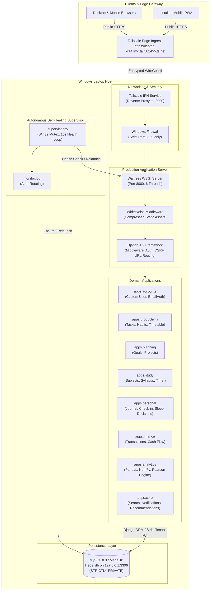

# LifeOS — Personal Behavioral Intelligence

> **A Debugger for Humans.**  
> A multi-user behavioral intelligence and life management platform designed to capture, understand, and optimize the multi-dimensional relationships between planning, daily habits, states of mind, and life outcomes.

---

> [!IMPORTANT]
> ### 🌐 Live Demonstration Links
> - **Live Application:** [https://laptop-lkra47mc.tail581455.ts.net/](https://laptop-lkra47mc.tail581455.ts.net/)
> - **User Login:** [https://laptop-lkra47mc.tail581455.ts.net/accounts/login/](https://laptop-lkra47mc.tail581455.ts.net/accounts/login/)
> - **User Registration:** [https://laptop-lkra47mc.tail581455.ts.net/accounts/register/](https://laptop-lkra47mc.tail581455.ts.net/accounts/register/)
> - **Health-Check Endpoint:** [https://laptop-lkra47mc.tail581455.ts.net/health/](https://laptop-lkra47mc.tail581455.ts.net/health/)
>
> **Hosting & Availability Notice**: This live application is hosted on a dedicated Windows development laptop utilizing **Tailscale Funnel** for encrypted, public HTTPS access. It is accessible whenever the host laptop, internet connection, Tailscale background service, and LifeOS application server are operational. It is an edge-hosted personal demonstration environment rather than a 24/7 cloud-managed cluster.

---

## 1. Project Overview & Philosophy

Most productivity applications operate as isolated silos: a to-do list here, a habit tracker there, a separate study timer, and a disconnected mood journal. Consequently, users never see the underlying invisible patterns governing their performance and well-being:
* *How does 6 hours of sleep versus 8 hours impact deep work completion?*
* *Does study session length correlate with topic retention or exam scores?*
* *Which habits trigger productive workdays, and which ones induce friction?*
* *What cognitive biases repeatedly lead to regrettable decisions?*

**LifeOS** operates as **a debugger for human behavior**. By systematically connecting planning, daily habits, task completion, mood, energy, sleep, decision-making, and financial activity into a unified relational data model, LifeOS uncovers behavioral correlations and delivers actionable insights to help individuals make better decisions.

### Core Architectural Principles
1. **Multi-User Data Isolation**: Complete tenant privacy. Every model enforces explicit user-level ownership checks preventing Insecure Direct Object References (IDOR).
2. **Behavioral Intelligence**: Multi-dimensional correlation engine calculating Pearson correlation coefficients ($N \ge 14$ threshold) across biometrics, habits, and productivity.
3. **Cognitive Calm & Minimalist UI**: Dark-mode design system built on CSS custom properties and semantic tokens, eliminating visual clutter.
4. **Data Sovereignty**: Zero lock-in. Full self-service single JSON backups and multi-table CSV / ZIP downloads.
5. **Self-Healing Edge Hosting**: Production WSGI architecture on Windows with autonomous monitoring, automated recovery, and zero cloud expenses.

---

## 2. Technology Stack

| Layer | Technologies & Tools |
| :--- | :--- |
| **Backend Framework** | **Python 3.13**, **Django 4.2 LTS** (ORM, Custom Auth, Security Middleware) |
| **Database Engine** | **MySQL 8.0** / **MariaDB 10.4+** via `mysqlclient` and Django ORM (3NF, strict integrity constraints) |
| **Data Science & Analytics** | **Pandas**, **NumPy** (data wrangling, rolling metrics), **Plotly** (interactive time-series, correlation matrices) |
| **Frontend Architecture** | **Semantic HTML5**, **CSS3 with Design Tokens / CSS Variables**, **Modern Vanilla JavaScript (ES6+)** |
| **Design & Typography** | **Inter Font Family** (400, 500, 600, 700), Minimal Modern Dark Canvas (`#0F1117`) with Soft Indigo (`#818CF8`) |
| **Production WSGI Server** | **Waitress** (`waitress>=3.0.0`) multi-threaded WSGI server (port 8000) |
| **High Availability & Supervision** | Custom autonomous supervisor (`supervisor.py`) with Win32 Named Mutex single-instance locking |
| **Public Networking & Tunneling** | **Tailscale Funnel** (MagicDNS, Let's Encrypt automated TLS) + **Cloudflare Quick Tunnel** fallback |
| **Static File Optimization** | **WhiteNoise** with Gzip/Brotli compression and persistent caching |
| **Mobile & PWA Support** | Web App Manifest (`manifest.json`), Service Worker (`service-worker.js`) |

---

## 3. Application Architecture



---

## 4. Main Features & Modular System

LifeOS organizes personal behavioral intelligence across structured domains:

### 1. Executive Dashboard (`/dashboard/`)
* **Real-time Metrics**: Today's task completion velocity, active habit streak completion %, total study focus time, and active quarterly goal progress.
* **Interactive Quick Actions**: One-click task completion toggle, instant habit check-in, and quick biometric check-in modal.
* **Contextual Streams**: Chronological schedule blocks, upcoming examinations, and recent multi-module activity feed.

### 2. Productivity & Daily Rhythm (`/productivity/`, `/timetable/`)
* **Task Manager**: Priority matrix (P1–P4), multi-attribute filtering, search, time estimation vs. actual duration tracking.
* **Habits & Streaks**: 30-day visual matrix, daily/weekly streak engine, consistency tiers, and pause/active toggles.
* **Daily & Weekly Timetable**: Chronological timeline, drag/reschedule capabilities, and 7-day Monday–Sunday visual calendar.
* **Smart Generator Engine**: Deterministic rule-based scheduling engine prioritizing study commitments, task urgency, rest breaks, and fatigue bounds.
* **Activity Stopwatch**: Live start/stop timer for deep work sessions with automatic duration calculation.

### 3. Study Management & Academic Syllabi (`/study/`)
* **Syllabus Progress Tracker**: Subjects, courses, topics, chapter units, and behind-schedule alerts.
* **Live Study Stopwatch**: Focus sessions with focus ratings (1–10), auto-closure of dangling sessions, and syllabus velocity charts.
* **Revision Planner**: Spaced repetition iterations with overdue, today, and upcoming queues.
* **Exams & Assessments**: Examination schedules, countdown timers, and target score tracking.

### 4. Personal Well-being & Cognitive Logging (`/personal/`)
* **Daily Check-in**: Standardized 5-point Likert scales for Mood, Energy, and Stress levels.
* **Sleep Tracker**: Overnight duration calculator handling midnight crossings, quality ratings, and benchmark bands (7.0–8.5h).
* **Introspective Journal**: Rich markdown reflections with full-text search and date range filtering.
* **Decision Journal**: Structured decision lifecycle (Draft $\rightarrow$ Evaluating $\rightarrow$ Decided $\rightarrow$ Reviewed), option payoffs, and post-mortem outcome scoring.
* **Mistake Tracker**: Anti-pattern documentation, root-cause triggers, severity impacts, and mitigation action plans.

### 5. Financial Management (`/personal/finance/`)
* **Income & Expense Tracking**: Strict positive decimal transactions in INR (₹).
* **Cash Flow Analytics**: Monthly net balance, savings rate, category-wise breakdowns, and ledger search.

### 6. Behavioral Intelligence & Analytics (`/analytics/`)
* **Cross-Dimensional Correlations**: Powered by Pandas and NumPy, calculating Pearson correlation coefficients ($r$) with statistical significance thresholds ($N \ge 14$).
* **Interactive Charts**: Powered by Plotly and lightweight CSS visualizations.
* **Behavioral Insights Engine**: Deterministic heuristic rules generating actionable insights (e.g. *"When sleep is $\ge 7.5$ hours, deep work completion increases by 34%"*).
* **Period Comparison Scorecard**: Comparing current vs. previous 7-day, 30-day, and 90-day performance with zero-division safeguards.

### 7. Core Cross-Cutting Services
* **In-App Notifications**: Proactive, deduplicated alerts for overdue tasks, upcoming exams, spaced revisions, and habit streaks.
* **Global Multi-Entity Search**: Instant cross-entity search spanning 10 core LifeOS models.
* **Personalized Recommendations**: Heuristic recommendations with dismiss/restore capabilities.
* **Data Sovereignty & Export**: Single-click full JSON export and multi-table CSV/ZIP archive download.

---

## 5. UI Showcase & Visual Design System

LifeOS uses a custom dark-mode design system built from scratch with zero heavy CSS framework bloat:

```
+-----------------------------------------------------------------------------------+
|  LifeOS               🔍 Global Search...              🔔 (3)   👤 Priyani Rathod |
+------------------+----------------------------------------------------------------+
|  MY DAY          |  Welcome back, Priyani                     Wednesday, 12 Nov   |
|  📊 Dashboard    |  +----------------+ +----------------+ +---------------------+ |
|  📅 Timetable    |  | Tasks Done     | | Habit Streak   | | Deep Work Focus     | |
|  ✅ Tasks        |  | 8 / 10 (80%)   | | 14 Days Active | | 4 hrs 15 mins       | |
|  🔁 Habits       |  +----------------+ +----------------+ +---------------------+ |
|  ⏱️ Activities   |                                                                |
|                  |  Today's Timetable               Behavioral Insights           |
|  MY GROWTH       |  [09:00 - 10:30] Deep Work       💡 Higher sleep duration (8h) |
|  📚 Study Hub    |  [10:45 - 12:00] Mathematics        correlated with +38% study |
|  🎯 Goals        |  [14:00 - 15:30] Project Sprint     focus rating this week.    |
|  📁 Projects     |                                                                |
|  📝 Journal      |  Active Habits                   Recent Activity               |
|  ⚖️ Decisions    |  [x] Morning Meditation (14d)    - Finished Task: API Spec     |
|                  |  [x] 2.5L Water (8d)             - Logged 90m Study Session    |
|  INTELLIGENCE    |  [ ] Evening Reading (5d)        - Check-in: Energy 4/5        |
|  📈 Analytics    +----------------------------------------------------------------+
+-----------------------------------------------------------------------------------+
```

### Visual Token Hierarchy (`static/css/variables.css`)
* `--bg-primary: #0F1117` (Deep charcoal canvas)
* `--bg-sidebar: #151821` (Structured navigation tone)
* `--bg-card: #1B1F2A` (Elevated component card surfaces)
* `--accent-primary: #818CF8` (Soft indigo focal color)
* `--text-primary: #F3F4F6` (High-contrast typography)
* `--text-secondary: #9CA3AF` (Refined descriptive metadata)
* `--success: #34D399` | `--warning: #FBBF24` | `--danger: #F87171` (Semantic status indicators)

---

## 6. Project Directory Structure

```
LifeOS/
├── manage.py                     # Django CLI administrative entry point
├── requirements.txt              # Production and development dependencies
├── .env.example                  # Safe configuration template (committed)
├── .env                          # Local credentials (STRICTLY GIT-IGNORED)
├── .gitignore                    # Git exclusion rules
├── README.md                     # Project manual & presentation documentation
├── PROJECT_CONTEXT.md            # System mission & architectural blueprint
├── DEVELOPMENT_PROGRESS.md       # Milestone roadmap & development log
├── DATABASE_SCHEMA.md            # Relational database schema reference
├── DEPLOYMENT.md                 # Production deployment operations manual
├── LOCAL_HOSTING_GUIDE.md        # Local laptop & Wi-Fi LAN setup guide
├── PUBLIC_ACCESS_GUIDE.md        # Tailscale Funnel public access manual
├── DATABASE_BACKUP_GUIDE.md       # Backup and disaster recovery manual
│
├── serve.py                      # Multi-threaded Waitress WSGI production server
├── supervisor.py                 # Autonomous supervisor & health monitor daemon
├── start_lifeos.bat              # One-click startup script (MySQL check + supervisor)
├── stop_lifeos.bat               # One-click graceful shutdown script
├── stop_lifeos.ps1               # Clean process termination engine
├── restart_lifeos.bat            # One-click safe restart script
├── launch_lifeos_background.vbs  # Headless Windows Startup launcher
├── start_tailscale_funnel.bat    # Permanent Tailscale Funnel activator
├── start_tunnel.bat              # Cloudflare Quick Tunnel alternative
├── backup_database.bat           # Automated MySQL timestamped backup utility
│
├── config/                       # Core Django configuration
│   ├── settings.py               # Database, auth, security, timezone settings
│   ├── urls.py                   # Master URL routing table
│   ├── wsgi.py                   # WSGI entry point
│   └── asgi.py                   # ASGI entry point
│
├── apps/                         # Modular Django applications
│   ├── accounts/                 # Custom User, authentication backends, profiles
│   ├── core/                     # Dashboard, global search, notifications, export
│   ├── productivity/             # Tasks, Categories, Habits, Timetable, Routines
│   ├── planning/                 # Goals, Projects, Milestones
│   ├── study/                    # Subjects, Topics, Syllabi, Timers, Revisions
│   ├── personal/                 # Journal, Daily Check-in, Sleep, Decisions, Mistakes
│   ├── finance/                  # Ledger transactions and cash flow analytics
│   └── analytics/                # Pearson correlation engine, charts, insight rules
│
├── templates/                    # Clean HTML5 presentation layer
│   ├── base.html                 # Master HTML5 template
│   ├── layouts/app_layout.html   # Three-tier authenticated layout
│   └── pages/                    # Domain views (dashboard, tasks, study, etc.)
│
├── static/                       # Static UI assets
│   ├── css/                      # CSS variables, typography, layout, components
│   ├── js/                       # Modular ES6 interactive UI scripts
│   └── images/                   # Vector marks and icon assets
│
└── backups/                      # Timestamped database backups (GIT-IGNORED)
```

---

## 7. Local Installation & Setup

### Prerequisites
* **Python 3.10 – 3.13** installed on your system.
* **MySQL 8.0** or **MariaDB 10.4+** (e.g. via XAMPP or standalone service).
* **Git** version control.

### Step-by-Step Setup

1. **Clone the Repository**:
   ```bash
   git clone https://github.com/priyanirathod13-cell/LifeOs.git
   cd LifeOs
   ```

2. **Create and Activate Virtual Environment**:
   ```powershell
   # Windows (PowerShell)
   python -m venv .venv
   .\.venv\Scripts\Activate.ps1
   ```

3. **Install Dependencies**:
   ```powershell
   pip install -r requirements.txt
   ```

4. **Configure Environment Variables**:
   ```powershell
   Copy-Item .env.example .env
   ```
   Open `.env` and configure your local MySQL database credentials:
   ```ini
   SECRET_KEY=your-secure-random-secret-key-here
   DEBUG=True
   ALLOWED_HOSTS=127.0.0.1,localhost,.ts.net
   CSRF_TRUSTED_ORIGINS=http://127.0.0.1:8000,http://localhost:8000,https://*.ts.net
   DB_NAME=lifeos_db
   DB_USER=root
   DB_PASSWORD=
   DB_HOST=127.0.0.1
   DB_PORT=3306
   TIME_ZONE=Asia/Kolkata
   LANGUAGE_CODE=en-us
   ```

5. **Initialize Database & Run Migrations**:
   Ensure MySQL is active on port 3306, then execute:
   ```powershell
   python manage.py migrate
   ```

6. **Run System Checks and Automated Test Suite**:
   ```powershell
   python manage.py check
   python manage.py test
   ```

---

## 8. Managing LifeOS: Start, Stop & Restart

LifeOS provides dedicated management utilities for both interactive development and background autonomous hosting:

| Action | Recommended Command / Script | Behavior |
| :--- | :--- | :--- |
| **Start Service** | Double-click [`start_lifeos.bat`](start_lifeos.bat) | Checks MySQL, runs migrations, acquires Named Mutex, and starts the supervisor. |
| **Stop Service** | Double-click [`stop_lifeos.bat`](stop_lifeos.bat) | Gracefully terminates supervisor, Waitress WSGI, and frees port 8000 via PowerShell. |
| **Restart Service** | Double-click [`restart_lifeos.bat`](restart_lifeos.bat) | Calls `stop_lifeos.bat`, delays 3 seconds, and relaunches `start_lifeos.bat`. |
| **Background Auto-Start** | Handled via Windows Startup (`LifeOS.lnk`) | Silently executes `launch_lifeos_background.vbs` upon Windows user login. |
| **Manual Dev Server** | `python manage.py runserver` | Standard Django interactive development server on `127.0.0.1:8000`. |
| **Manual Production Server** | `python serve.py` | Multi-threaded Waitress WSGI server directly bound to `0.0.0.0:8000`. |

---

## 9. Automated Testing & Verification

LifeOS maintains an extensive automated test suite covering authentication, permissions, multi-user isolation, database check constraints, scheduling algorithms, and analytics calculations.

### Running the Test Suite
```powershell
# Run full test suite across all 8 apps
python manage.py test

# Run specific functional test suites
python manage.py test apps.core.tests.CoreAndLandingTests
python manage.py test apps.accounts
python manage.py test apps.productivity
python manage.py test apps.study
python manage.py test apps.personal
python manage.py test apps.finance
python manage.py test apps.analytics
```

### Key Test Coverage Areas
* **Health-Check API**: `GET /health/` verifies database connectivity (`SELECT 1`) and responds with `HTTP 200` (`status: ok`).
* **Tenant Isolation**: Verifies that User A cannot read, edit, or delete User B's tasks, habits, projects, or journals.
* **Authentication Security**: Case-insensitive email normalization, password hashing, timing-attack mitigation, and CSRF enforcement.
* **Integrity Constraints**: Positive monetary values (`amount > 0`), valid Likert ratings ($1 \le \text{score} \le 5$), and sleep duration consistency.

---

## 10. Public Access & Edge Hosting Architecture

### Permanent Public HTTPS via Tailscale Funnel
* **Architecture**: The Waitress production server listens on `0.0.0.0:8000`. Tailscale's Windows service accepts public internet traffic at `https://laptop-lkra47mc.tail581455.ts.net/` and proxies requests to `http://127.0.0.1:8000`.
* **Zero Cloud Expenses**: 100% free forever with automated Let's Encrypt certificates.
* **Strict MySQL Isolation**: Port 3306 is bound to loopback `127.0.0.1:3306` and is **never** forwarded to the public internet.
* **Troubleshooting DNS**: If `DNS_PROBE_FINISHED_NXDOMAIN` occurs immediately upon laptop boot, allow 15 seconds for Tailscale network synchronization, then press `Ctrl + F5` to refresh the browser.

For complete deployment details and alternatives, refer to:
* [`DEPLOYMENT.md`](DEPLOYMENT.md) — Production operations manual.
* [`PUBLIC_ACCESS_GUIDE.md`](PUBLIC_ACCESS_GUIDE.md) — Tailscale Funnel & Cloudflare Quick Tunnel guide.
* [`LOCAL_HOSTING_GUIDE.md`](LOCAL_HOSTING_GUIDE.md) — Wi-Fi LAN access & PWA setup.
* [`DATABASE_BACKUP_GUIDE.md`](DATABASE_BACKUP_GUIDE.md) — Disaster recovery & automated backups.

---

## 11. Project Presentation Summary

| Attribute | Details |
| :--- | :--- |
| **Project Name** | **LifeOS** |
| **Tagline** | **Personal Behavioral Intelligence — A Debugger for Humans** |
| **Author** | **Priyani Rathod** |
| **Repository** | [https://github.com/priyanirathod13-cell/LifeOs](https://github.com/priyanirathod13-cell/LifeOs) |
| **Live URL** | [https://laptop-lkra47mc.tail581455.ts.net/](https://laptop-lkra47mc.tail581455.ts.net/) |
| **Hosting Model** | Edge-hosted Windows Laptop with Tailscale Funnel & Autonomous Supervisor |
| **Status** | Production-Ready, Feature-Complete, Multi-User Isolated |

---

*LifeOS — Built with passion to help humans understand, debug, and optimize their daily lives.*
